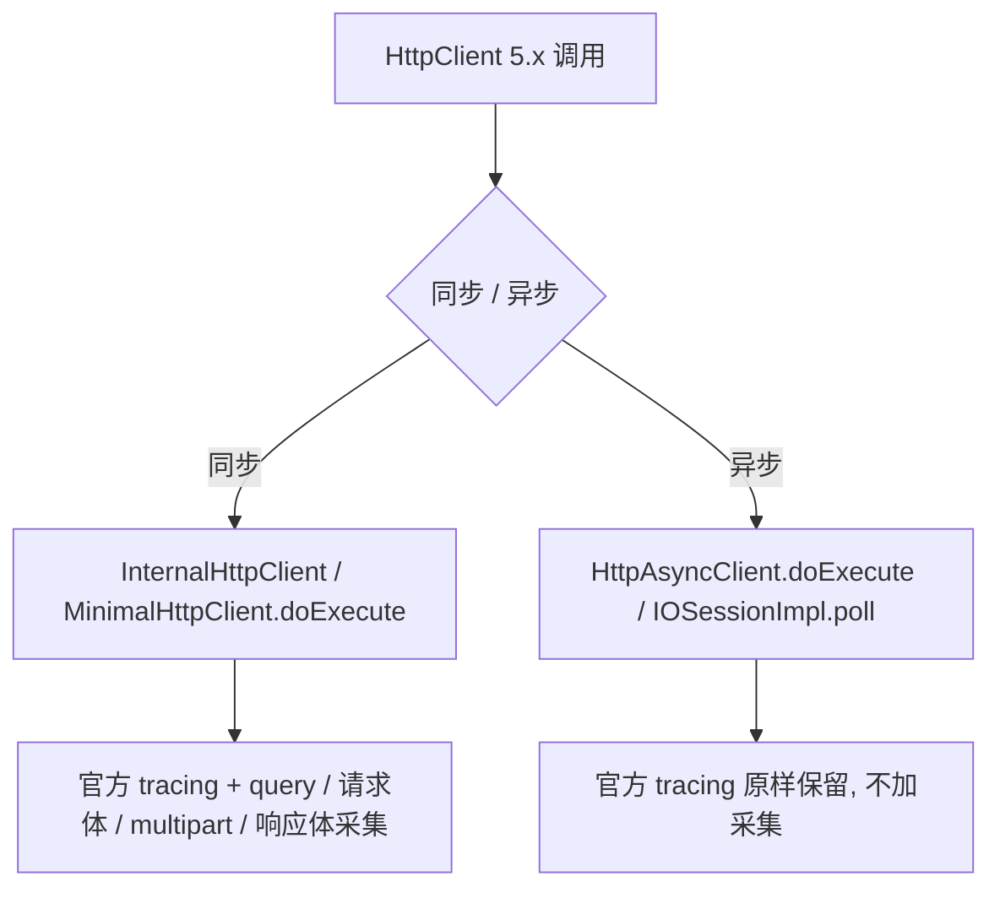

# override-httpclient-5.x-plugin

全量替代 SkyWalking 9.4.0 官方 `apm-httpclient-5.x-plugin`:同步路径(`InternalHttpClient` / `MinimalHttpClient`)保留 tracing 并补充入参/出参采集;异步路径(`HttpAsyncClient` / `IOSessionImpl`)原样保留、不加采集。



## 构建

```bash
mvn -q -pl override-httpclient-5.x-plugin -am clean test
mvn -q -pl override-httpclient-5.x-plugin -am package -DskipTests
```

产物:`override-httpclient-5.x-plugin/target/override-apm-httpclient-5.x-plugin-9.4.0.jar`

也可用仓库级脚本一次构建并导出三个 override 插件:

```bat
E:\gitRepository\_skywalking-javaPluginExtensions\agent\build-export-skywalking-override-plugins.bat
```

## 采集开关模型

与 4.x override 同构,采集职责拆分:

| 用途 | 配置 key | 默认 |
|------|----------|------|
| query string(官方) | `plugin.httpclient.collect_http_params` | `false` |
| 请求体 / 表单 / multipart / 响应体(override) | `plugin.overridehttpclient5.collect_http_params` | `false` |
| 裁剪长度(官方,共用) | `plugin.http.http_params_length_threshold` | `1024` |

- `application/x-www-form-urlencoded` 采为 `form=...`
- multipart 文本字段进 `http.request.params`,文件项记 `filename / size / contentType` 进 `http.request.files`
- 响应体只在实体可重复时采集(repeatable-only);不可重复的流/解压包装跳过,避免消费业务响应流

## 运行时开关

宿主工具类:`org.apache.skywalking.apm.toolkit.SWHttpClient5CollectUtils`

```java
SWHttpClient5CollectUtils.enableCollect(Collections.emptyMap());
SWHttpClient5CollectUtils.disableCollect(Collections.emptyMap());
SWHttpClient5CollectUtils.statisticStatus();
```

状态 map 键:`officialCollectHttpParams` / `overrideCollectHttpParams` / `httpParamsLengthThreshold`。
运行时开关只改 override 开关(请求体/响应体),不动官方 query 开关。

## 部署注意

部署前移走官方 `apm-httpclient-5.x-plugin-*.jar`(脚本会自动挪到 `optional-plugins/`),否则同步路径会被官方与本插件双重增强。

本插件与 `override-httpclient-4.x-plugin` 可同时装载:两者增强的类不同(4.x 是 `org.apache.http.*`,5.x 是 `org.apache.hc.*`),toolkit 类名也不同,互不冲突。

## 异步路径为什么"未修改"

本插件整包替代官方插件,必须自带异步增强,否则移除官方 jar 后异步调用将完全失去链路。因此 `HttpAsyncClientDoExecuteInterceptor`、`IOSessionImplPollInterceptor`、`AsyncResponseConsumerWrapper`、`FutureCallbackWrapper` 及两个 define 均**逐字复制自官方 v9.4.0、保持原样**,异步路径不加任何采集。请勿在未同步上游的情况下改动这些文件。
