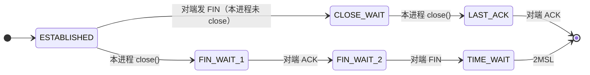

# Zuul 1.x 网关的 CLOSE_WAIT / FIN_WAIT_2 判读

- **何时读**：网关（Zuul 1.x，Windows 本机）上出现大量 `CLOSE_WAIT` / `FIN_WAIT_2`；
  要判断它们出在**入站**（客户端→网关）还是**出站**（网关→后端）；或有人拿"端口池耗尽"那套结论来套这两个状态时。
- **性质**：**诊断清单**。机制来自 TCP 挥手语义 + Zuul 1.x（**Undertow** Servlet 容器 + Apache HttpClient 连接池）架构，
  **尚未对 Zuul 实跑采样验证** —— 每条判据都配了"怎么证"（见附录 A）。
  与 [`2026-10-02-tcp-port-pool-exhaustion-and-a-measurement-trap.md`](./2026-10-02-tcp-port-pool-exhaustion-and-a-measurement-trap.md)
  是**互补的两类病**，判据不通用（见 §五）。
- **读者假设**：知道 keep-alive；知道 Zuul 1.x 的 filter 链是**阻塞式**——一个在途请求占住一个
  **Undertow worker 线程**（本网关的 Servlet 容器是 **Undertow**）。

---

## 零、三句话

> **① `CLOSE_WAIT`＝对端发了 FIN，本进程没 `close()`。** 内核**不会超时清理**，只增不减就是
> **本地 socket 泄漏 / 工作线程卡住** —— 持有该 socket 的**本地进程（＝网关自身，那个 JVM）**没关，
> 这是最硬的"本地应用侧锅"信号。**"应用侧"指持有这条 socket 的本网关进程，不是下游被代理的服务。**
>
> **② `FIN_WAIT_2`＝本进程已 `close()`（发了 FIN），在等对端 FIN。** 堆着不降 = 对端不回，
> 或本地 fd 根本没释放（半关闭 / 泄漏）。
>
> **③ 这两个状态不吃端口池**，与 10-02 那篇的 `TIME_WAIT` 是两回事：那篇是"主动关得太快太多"，
> 这篇是"被动关 / 没关"。所以 `netsh int tcp reset` 那套应急**对它们无效**。

> **别把"谁发的 FIN"当成"谁的锅"**：入站时 FIN 来自客户端，出站时 FIN 来自**下游**——但两种情况里
> 堆在 `CLOSE_WAIT` 的 socket 都是**网关自己攥着没关**（下游发完 FIN 就退出，它那边是 `TIME_WAIT`/`CLOSED`）。
> 所以**下游先关是诱因，修复点在网关侧**（池要能感知对端关闭）；把下游 keep-alive 调长只是配合。

---

## 一、三个状态的归属



| 状态 | 谁先发 FIN | 卡在谁 | 内核会自己清吗 | 含义 |
| --- | --- | --- | --- | --- |
| **CLOSE_WAIT** | **对端** | **本进程没 `close()`** | **不会** | 本地 socket 泄漏 / 线程卡住 |
| **FIN_WAIT_2** | **本进程** | 等对端 FIN | 仅当 fd 已释放才受 `tcp_fin_timeout` 兜底 | 对端不关，或本地 fd 没真释放 |
| TIME_WAIT | 本进程（主动关） | 2MSL | 会 | 正常；多＝短连接太多（见 10-02 篇） |

- **只增不减** → 泄漏。
- **卡在固定上限**（如恒为 200 / 池上限）→ 池或线程池满，不是无界泄漏。

---

## 二、判据：入站还是出站（Windows）

一句话：**`Local` 端口对得上网关监听端口＝入站；`Foreign` 端口对得上后端端口＝出站。**

| 判据 | 入站（网关＝server） | 出站（网关＝client，连后端） |
| --- | --- | --- |
| **Local 端口** | = 监听端口（`server.port`） | = 随机高端口 |
| **Foreign 端口** | 客户端随机端口，分散 | 后端端口，集中在少数 |
| 归属 PID | 网关 `java.exe` | 同一个 `java.exe` |
| Zuul 含义 | 客户端先超时/断开，Undertow worker 线程还卡在等后端 | 后端 keep-alive 先关，HttpClient 池没踢 |

```powershell
# 1) 网关 PID 与它的监听端口集合（入站的锚点）
$gwPid       = (Get-NetTCPConnection -LocalPort 8080 -State Listen).OwningProcess   # 换成你的 server.port
$listenPorts = (Get-NetTCPConnection -OwningProcess $gwPid -State Listen).LocalPort

# 2) 把 CLOSE_WAIT / FIN_WAIT_2 分到入站/出站
$rows = netstat -ano -p tcp | Select-String 'CLOSE_WAIT|FIN_WAIT_2' | ForEach-Object {
  $f  = ($_.Line.Trim() -split '\s+')                       # TCP  Local  Foreign  State  PID
  $lp = [int]($f[1].Substring($f[1].LastIndexOf(':')+1))    # 兼容 [::1]:x
  $fp = [int]($f[2].Substring($f[2].LastIndexOf(':')+1))
  [pscustomobject]@{
    Dir = if ($listenPorts -contains $lp) {'入站'} else {'出站'}
    State = $f[3]; Local = $f[1]; Foreign = $f[2]; FLocal = $lp; FForeign = $fp; PID = [int]$f[4]
  }
} | Where-Object PID -eq $gwPid

$rows | Group-Object Dir, State | Select Name, Count | Sort Count -Descending
$rows | Where-Object Dir -eq '出站' | Group-Object FForeign |
  Sort Count -Descending | Select -First 5 Count, @{n='后端端口';e={$_.Name}}
```

不写脚本的肉眼判据：

```
TCP  127.0.0.1:8080    127.0.0.1:51423    CLOSE_WAIT   12345   ← Local=监听口 → 入站
TCP  127.0.0.1:51999   127.0.0.1:9600     CLOSE_WAIT   12345   ← Foreign=后端口 → 出站
```

后端端口集合取自 `zuul.routes.*.url` 或 Ribbon `listOfServers` / `serviceId`。

---

## 三、Zuul 1.x 各自含义与改法

**入站 `CLOSE_WAIT`（Local ＝ 监听端口）**
Undertow 是 NIO：**IO 线程**（`server.undertow.threads.io`，默认＝CPU 核数）管 socket 事件，
**worker 线程**（`threads.worker`，默认＝IO×8）跑阻塞的 Servlet / 过滤器链。Zuul 1 的 filter 链**同步**调
`RibbonRoutingFilter` / `SimpleHostRoutingFilter` 等后端 → 占住一个 worker 线程。

客户端先超时/断开并发 FIN：Undertow 的 IO 线程读到 EOF，按 **HTTP 半关闭**处理——读侧关掉，
但**为把响应写回去，连接仍握在服务端**。这段"响应还没写完"的窗口里 socket 就是 `CLOSE_WAIT`；
直到 worker 线程返回、响应写完，才 `close()` → LAST_ACK 收尾。

| 特征 | 方向 |
| --- | --- |
| `CLOSE_WAIT` 数 ≈ 卡在后端的 worker 线程数，随 `server.undertow.threads.worker`（默认 IO×8）封顶；伴随后端 RT 升高、worker 队列积压 | 对齐**超时链**：客户端 > 网关 > 后端；查 `zuul.host.connect-timeout-millis` / `socket-timeout-millis`、Ribbon `ConnectTimeout` / `ReadTimeout` |

**出站 `CLOSE_WAIT`（Local ＝ 随机高端口，Foreign ＝ 后端端口）**
下游默认 Apache HttpClient 连接池（`ProxyHttpClientFactory`；serviceId 路由走 Ribbon `RibbonLoadBalancingHttpClient`）。
空闲连接躺在池里没人读，后端 keep-alive 超时先发 FIN，HttpClient 只在**下次租用**才校验陈旧 → 窗口内全 `CLOSE_WAIT`。

| 特征 | 方向 |
| --- | --- |
| Foreign 集中在后端端口；数量 ≈ 池上限×后端数（`zuul.host.maxPerRouteConnections` / `maxTotalConnections`，**按你的版本核对属性名**） | 让**池空闲回收 < 后端 keep-alive**（或后端调长）；或改 OkHttp（`ribbon.okhttp.enabled=true`）并配好池 |

**`FIN_WAIT_2`**
网关已 `close()`、对端不回 FIN。多见于**流式代理半关闭**（WebSocket/SSE/gRPC：一端关了没关另一端），
或后端异常 / LB / NAT 静默丢 FIN。

---

## 四、对照实验（一改一看）

| 实验 | 观察 | 结论 |
| --- | --- | --- |
| 重启后端 | 出站 `CLOSE_WAIT` 暴增 | 池不感知对端关闭 |
| 池 `maxIdleTime` 调小于后端 keep-alive | `CLOSE_WAIT` 消失 | 坐实上一条 |
| 客户端侧主动断开/取消请求 | 入站 `CLOSE_WAIT` 涨 | Undertow worker 线程阻塞（超时链） |
| 关掉部分注册的代理服务 | 线性减少 | 每注册一个下游漏一条/一池 |
| 去掉 skywalking `-javaagent` 重跑 | 消失 | 插件插桩漏关（见 §五） |

---

## 五、与 10-02 那篇的边界

| | 10-02 篇（`TIME_WAIT`） | 本篇（`CLOSE_WAIT` / `FIN_WAIT_2`） |
| --- | --- | --- |
| 谁主动关 | 本机主动关 | **对端关（CLOSE_WAIT）/ 本机关但对端不回（FIN_WAIT_2）** |
| 资源被耗尽 | 端口池（ephemeral port） | fd / 连接池槽位 / 工作线程 |
| 典型诱因 | 短连接太多（Tomcat 8 个状态码强制 close） | 应用没关 socket / 池不感知对端关闭 |
| 应急 | `netsh int tcp reset` 有效 | **无效**，得从应用侧关连接 |

**别拿 10-02 的结论套这两个状态** —— 那是**另一个系统**（10-02 的 demo-app 是内嵌 **Tomcat**，本篇网关是
**Undertow**）、不同机制。若网关挂了 skywalking java agent，
"socket 插件在异常路径没关流"是值得优先 A/B 的假设（去掉 agent 重跑看是否消失）。

---

## 附录 A、未验证项（先证再改）

本清单**未对 Zuul 实跑采样**，下列每条都需实测后才可当结论引用：

| 论断 | 怎么证 |
| --- | --- |
| 入站不关由"worker 线程阻塞在后端"引起 | `jstack` 看 **Undertow worker 线程**（栈名含 `XNIO`/`worker`）是否停在下游调用；对齐超时后是否消失 |
| Undertow "半关闭后仍握连接"（→ 窗口内 `CLOSE_WAIT`） | 客户端断开瞬间连抓 `netstat` + `jstack`：`CLOSE_WAIT` 是否与卡住的 worker 线程一一对应、响应写完是否消失 |
| 出站堆积由"池只在租用校验陈旧"引起 | 池指标 idle 数只涨不落；`Foreign` 端口集中于后端 |
| Undertow 线程默认值 / Zuul 属性名 | 按你 Spring Boot / Undertow / Ribbon 版本读文档（`server.undertow.threads.*`、`zuul.host.*`），别照抄本文 |
| 插件插桩导致 fd 泄漏 | 去 `-javaagent` 做 A/B |

> 教训沿用 10-02 篇 **附录 A.3**：机制别猜。一次 `ss`/`netstat` 分类 + 一次 `jstack`，比编一个合理的故事便宜。

## 附录 B、PowerShell 坑

见 [`2026-10-02-tcp-port-pool-exhaustion-and-a-measurement-trap.md`](./2026-10-02-tcp-port-pool-exhaustion-and-a-measurement-trap.md) **附录 B**：
`netstat` 列错位、`$pid` 是保留字、连接上万时 `Get-NetTCPConnection` 每次 1~2 秒。
