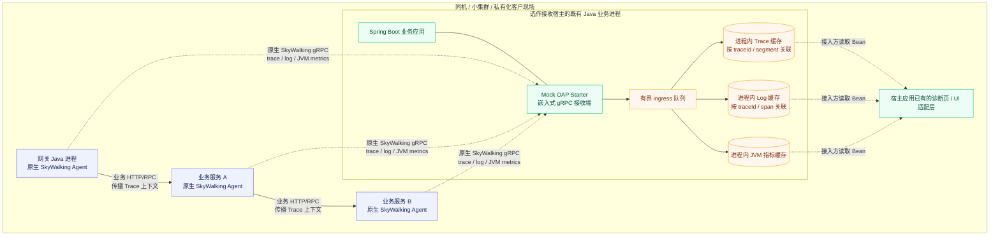
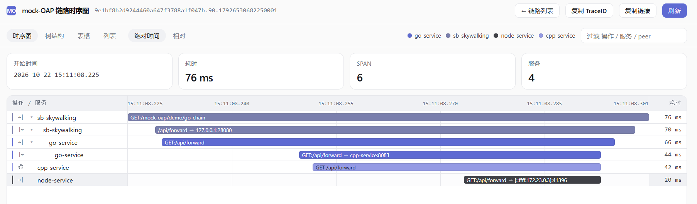
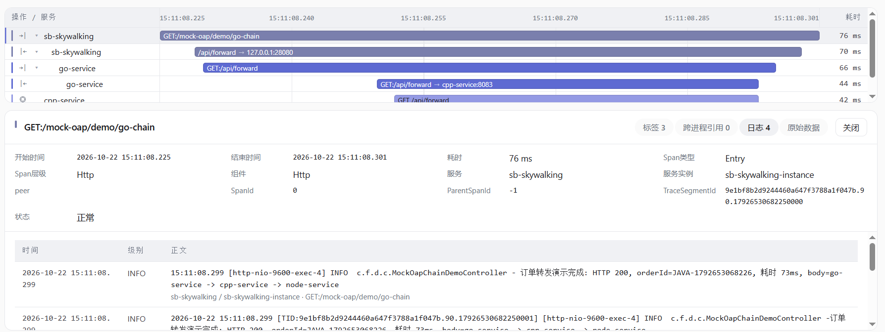

# skywalking-oap-mock-spring-boot-starter

进程内 mock-OAP collector，接收 SkyWalking 原生 agent 上报，并兼容标准 OTLP/gRPC trace。
用于本地联调、演示和测试，不替代真实 OAP。

## 运行架构与适用场景

Mock OAP 作为 Spring Boot starter **寄居在一个现有 Java 业务进程中**，让这个进程临时承担轻量接收端；其它 Java 服务继续使用原生 SkyWalking Java Agent，通过原生协议把 trace、log 等数据上报到它。无需额外部署 OAP / Elasticsearch，也不需要修改或定制 Agent。适合节点少、链路浅、部署在同机或客户隔离现场的“伪微服务”排障与演示场景。

- **Agent 保持原生**：不改 SkyWalking Agent、不加定制插件，也不改变其上报协议；只需把各服务的 `collector.backend_service` 指向宿主进程的地址和端口。
- **宿主就是业务进程**：在一台已有 Java 服务上引入 starter 并显式开启，不需要再起独立 OAP 进程。宿主本身仍通过 `-javaagent` 使用原生 SkyWalking Agent。
- **跨进程 Trace 可拼接**：Agent 产生的 Trace ID 与跨进程引用让浅层调用链可以在接收端关联；日志带有 Trace / Segment / Span 上下文时可与链路及 Span 对齐展示。
- **接入方负责展示**：starter 提供接收、处理和有界缓存 Bean，不包含 Controller、HTML 或 Web 依赖。图中的展示层由宿主应用已有页面或单独的 UI 适配模块提供。
- **轻量但非集中式长期存储**：数据保存在宿主进程的**有界内存缓存**中；进程重启后缓存清空。它适用于就地排障、演示和近期数据查看，不替代集中 OAP / Elasticsearch 的长期存储、跨大规模集群分析或审计留存。

### Trace 与 Log 展示示例

以下图片展示接入方 UI 对已接收数据的渲染效果；它们是展示示例，不代表 starter 内置了该页面。

**跨进程链路时序与 Span 明细：**

**按 Trace 上下文关联的日志：**

这类部署尤其适合[“伪微服务”、私有化交付与研发兼职运维](https://fulizhe.blog.csdn.net/article/details/161136408)：节点少、调用链浅、现场网络隔离，但仍需要跨进程查看 Trace 与关联 Log。规模、调用深度或留存要求超出进程内缓存边界时，应使用正式的集中式可观测性后端。

## 接入与构建

依赖声明、启用方式、Agent 前提、协议端口、配置项和可用 Bean 见[接入与构建指南](docs/usage.md)。

- **快速体验**：[demo](demo/README.md) —— 自带页面、演示流量与一键启动脚本，挂上 agent 即可看链路和日志。
- **方案介绍**：[在业务进程里 Mock 一个 OAP，把多语言链路泥沼一次性抽干](https://fulizhe.blog.csdn.net/article/details/168453067)
- **业务端示例**：[MockOapObservabilityController.java](https://gitee.com/lqzkcx3/javaLearning/blob/master/demo/sb-skywalking/sb-skywalking/src/main/java/com/fulizhe/demo/controller/MockOapObservabilityController.java)

## 与同类方案的边界

SkyWalking 官方测试工具链里有一个 **mock-collector**（[apache/skywalking-agent-test-tool](https://github.com/apache/skywalking-agent-test-tool)），描述为 "a SkyWalking receiver, like OAP server"。**本 starter 不是这个思路的首创者**，但两者运行位置不同，用途也不同：

- 官方 collector 是**独立进程**，用于 Agent 端到端测试，收到数据后导出 YAML 交给 validator 断言；
- 本 starter **寄居业务进程内**，用于现场排障，按 `traceId` 拼装跨进程链路，并保留有界缓存供宿主查询。

位置差异直接决定了技术栈：进程外的接收端可以放心使用标准 `io.grpc`；进程内的接收端若这么做，会被 Agent 的 `grpc-1.x` 插件埋点，形成"收段 → 生成 span → 再发段"的自激循环，真实链路会被挤出缓冲。因此本 starter 依赖 Agent 自带的 shaded gRPC。

与 Glowroot、JavaMelody、otlp-embedded 等嵌入式方案的逐项对比，以及各项目的许可证与近期活跃度，见 **[同类方案对比](docs/comparison.md)**。
