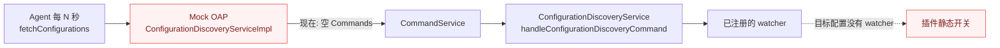

# TODO — 通过 CDS 动态下发插件调试开关

目标：让 Mock OAP 在**不改 Agent、不重启业务进程**的前提下，按 service 打开/关闭
`override-httpclient-4.x-plugin` 与 `override-hutool-http-5.x-plugin` 的采集开关。

当前状态：**未实现**。`ConfigurationDiscoveryServiceImpl` 只回空 `Commands`，没有任何存储或下发。
Agent 侧也没有为目标配置注册 `AgentConfigChangeWatcher`，所以即使 OAP 下发成功也不会生效。

## 1. 现在的链路断在哪



| 环节 | 现状 | 缺口 |
|---|---|---|
| OAP 响应 | 返回 `Commands.getDefaultInstance()` | 没有配置存储、没有 UUID、没有 `ConfigurationDiscoveryCommand` |
| 配置粒度 | 无 | 只有 `service` 维度可寻址 |
| Agent watcher | 仅 SDK 内置项（`agent.*`、jdbc 等）注册 | override 插件没有 watcher，收到配置也无人处理 |
| 业务侧入口 | 无 | 需要一个受控的写入入口（管理端接口） |

## 2. 下发协议约定（SkyWalking 9.4.0）

`fetchConfigurations(ConfigurationSyncRequest{service, uuid})` 返回 `Commands`，其中一条
`Command{command="ConfigurationDiscoveryCommand", args=[SerialNumber, UUID, key/value...]}`。

| 规则 | 行为 | 后果 |
|---|---|---|
| 请求 `uuid` 与当前版本相同 | 返回空 `Commands` | 省流量；版本号必须随配置内容变化 |
| 配置项被删除（响应里没有该 key） | Agent 合成空值 → watcher 收到 `DELETE` | watcher 必须能恢复默认值 |
| 值有变化 | watcher 收到 `MODIFY` | 值相同则不通知 |
| 未知 service | 返回空 `Commands` | 不影响其他服务 |
| watcher 没有对应 key | 该 key 被忽略 | 只影响目标插件 |

## 3. 配置键

| 键 | 归属 | 作用 |
|---|---|---|
| `plugin.overridehttpclient.collect_http_params` | `OverrideHttpClientPluginConfig` | override 插件体/响应采集开关；**Hutool 插件复用同一个开关** |
| `plugin.httpclient.collect_http_params` | SkyWalking 官方 `HttpClientPluginConfig` | 只控制 query 参数采集 |
| `plugin.httpclient.http_params_length_threshold`（以官方实际注册名为准） | 官方 | 采集截断阈值 |

注意：`@PluginConfig` 只在 Agent 启动时由 `ConfigInitializer` 注入静态字段，**不会**因为收到
CDS 配置自动更新；运行时更新必须由 watcher 显式写入。

## 4. 待做

### 4.1 Agent 侧（先做）

- [ ] 给 `override-httpclient-4.x-plugin` 注册 `AgentConfigChangeWatcher`，key 用
      `plugin.overridehttpclient.collect_http_params`。
      - watcher 在第一次拦截器调用时懒注册（与官方 jdbc 插件同法），或通过插件的
        `BootService` 在启动期注册；**具体挂载点需实测确认**。
      - `notify`：`MODIFY` → 解析布尔值；`DELETE` → 恢复启动时的默认值（`false`）。
      - `value()`：返回当前开关的字符串形式。
- [ ] `COLLECT_HTTP_PARAMS` 改为 `volatile`（配置线程写、业务线程读），否则可见性无保证。
- [ ] Hutool 插件无需第二个 key：`HutoolHttpCollectionSwitch` 已读同一开关；
      但要在文档里写清"一个开关管两个插件"。
- [ ] 验证删除语义：OAP 删 key 后，Agent 日志出现 `DELETE` 事件且开关回到 `false`。

> **前置假设**：本阶段 mock-oap 不与 `logfile-reporter-plugin` 同装。该插件里的
> `NoOpConfigurationDiscoveryService`（`@OverrideImplementor(ConfigurationDiscoveryService.class)`，
> `prepare`/`boot`/`statusChanged` 全空）会顶掉 Agent 的 CDS 客户端，使 Agent 完全不轮询。
> 当前部署不含它，所以不阻塞；若将来同装，必须先在两者间做取舍（排除该类或改成可配置开关）。

### 4.2 Mock OAP 侧

- [ ] 新增 `DynamicConfigRegistry`（Bean，可被自定义 Bean 覆盖）：
      - `Map<String service, Map<String key, String value>>`；
      - `version(service)`：对配置内容做稳定哈希，作为下发 UUID；
      - 写入/删除后版本自然变化；
      - 快照返回不可变副本，避免并发读改写。
- [ ] 改写 `ConfigurationDiscoveryServiceImpl`：

```java
// 概要，不是最终实现
if (request.getUuid().equals(registry.version(service))) {
    responseObserver.onNext(Commands.getDefaultInstance());
} else {
    responseObserver.onNext(Commands.newBuilder()
        .addCommands(Command.newBuilder()
            .setCommand("ConfigurationDiscoveryCommand")
            .addArgs(pair("UUID", registry.version(service)))
            .addAllArgs(registry.entries(service)))
        .build());
}
```

- [ ] 在 `MockOapGrpcServer` 的 `getIngestStats()` 里暴露配置版本与最后下发时间，便于排查。
- [ ] 业务侧写入入口：参考
      `MockOapObservabilityController`（javaLearning 仓库），由接入方自行提供 Controller；
      starter 只提供 registry Bean，不引 Web 依赖（与现有边界一致）。
- [ ] 单测：`ConfigurationDiscoveryServiceImplTests` 覆盖
      "UUID 未变返回空"、"首次下发含配置"、"删 key 后不再下发该 key"、"未知 service 返回空"。
- [ ] 集成测：用 Agent 同款 stub 调一次 `fetchConfigurations`，断言 `Commands` 可被
      `ConfigurationDiscoveryCommand.deserialize` 正确解析。

### 4.3 安全与边界

- [ ] 写入入口必须鉴权（内部 token / 仅本机可访问），不要把"改采集开关"暴露成匿名 GET。
- [ ] 配置键白名单：只允许下发已知 key，拒绝任意字符串透传到 Agent。
- [ ] 审计：记录谁在何时把哪个 service 的哪个 key 改成了什么值。
- [ ] TTL 自动回收：调试开关默认 N 分钟后自动恢复 `false`，避免采集体/响应体长期开着压垮内存。
- [ ] 文档写明粒度：CDS 只按 `service` 下发，同 service 的所有实例一起变；
      要单实例控制只能靠不同 service 名或另走控制通道。

## 5. 验收

- [ ] 宿主开启 `mock-oap.enabled=true`，Agent 日志可见周期性 `fetchConfigurations`。
- [ ] 管理端把 `plugin.overridehttpclient.collect_http_params` 置 `true` 后，
      **不重启**应用，下一次 HTTP 调用的 span 上出现 `http.request.params` / `http.response.body`。
- [ ] 置回 `false` 或删除配置后，标签停止产生。
- [ ] 未改配置的 service 不受影响；`uuid` 未变化时 OAP 返回空 `Commands`。
- [ ] `docs/usage.md` 增加「动态配置」小节，README 的架构图补一条 CDS 反向通道。

## 6. 相关文件

```text
oap/skywalking-oap-mock-spring-boot-starter/src/main/java/com/fulizhe/observability/mockoap/dynamicconfig/ConfigurationDiscoveryServiceImpl.java
oap/skywalking-oap-mock-spring-boot-starter/src/main/java/com/fulizhe/observability/mockoap/MockOapGrpcServer.java
oap/skywalking-oap-mock-spring-boot-starter/src/test/java/com/fulizhe/observability/mockoap/dynamicconfig/ConfigurationDiscoveryServiceImplTests.java
agent/override-httpclient-4.x-plugin/src/main/java/org/apache/skywalking/apm/plugin/override/httpclient/v4/OverrideHttpClientPluginConfig.java
agent/override-hutool-http-5.x-plugin/src/main/java/org/apache/skywalking/apm/plugin/hutool/v5/http/HutoolHttpCollectionSwitch.java
```

> 同装 `logfile-reporter-plugin` 时的冲突源（本阶段不涉及）：
> `agent/logfile-reporter-plugin/src/main/java/org/apache/skywalking/apm/plugin/dynamic/override/NoOpConfigurationDiscoveryService.java`
