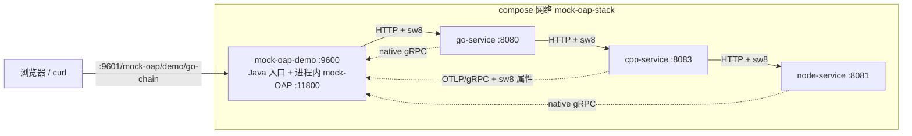

# 远端 Linux 服务器部署（mock-OAP 演示栈）

把 `demo/docker-compose.yaml` 这套**四语言链路（Java → Go → C++ → Node）**部署到一台 Linux 服务器。
一条命令起齐 + 一个地址看效果；踩过的坑集中在 §5，出问题先查那张表。

> 本地只想起来看一眼:`mvn -B package && docker compose up -d`(同一份 compose,不需要搬镜像)。
> **这份文档只讲远端 + 镜像搬运。**

---

## 0. 一键路径(已部署好的机器)

```bash
ssh root@172.16.1.108
cd /root/_demo_app_sw_oap_mock && docker compose up -d

# 生成一条跨语言链路
curl 'http://127.0.0.1:9601/mock-oap/demo/go-chain?hops=3&latency=20'
# => {"status":200,"body":"go-service -> cpp-service -> node-service",...}
```

浏览器打开 **`http://172.16.1.108:9601/`** → 点「生成链路(3 跳)」→ 从「采集总览」点 traceId 看时序图。

| 现象 | 期望 |
| --- | --- |
| `docker compose ps` | 4 个容器 Up,`mock-oap-demo` 为 `(healthy)` |
| `/mock-oap/status` | `running=true`、`agentBooted=true` |
| 一条链路的 trace | **4 segments / 6 spans**,服务是 `mock-oap-demo / go-service / cpp-service / node-service` |

---

## 1. 拓扑与端口



| 服务 | 镜像 | 宿主端口 | 容器内 | 上报地址 |
| --- | --- | --- | --- | --- |
| `mock-oap-demo` | `mock-oap/demo:2.0.0`(本目录 Dockerfile 构建) | **9601 → 9600** | 9600 / 11800 | `127.0.0.1:11800`(自己) |
| `go-service` | `mock-oap-emitters/go-service:1.0.0` | 无 | 8080 / 9090 | `SW_AGENT_REPORTER_GRPC_BACKEND_SERVICE=mock-oap-demo:11800` |
| `cpp-service` | `mock-oap-emitters/cpp-service:1.0.0` | 无 | 8083 | `OTEL_EXPORTER_OTLP_ENDPOINT=mock-oap-demo:11800` |
| `node-service` | `mock-oap-emitters/node-service:1.0.0` | 无 | 8081 | `SW_AGENT_COLLECTOR_BACKEND_SERVICES=mock-oap-demo:11800` |

- **只有 Java 对外**;emitter 全在 compose 内网,不占宿主端口。
- 容器内固定 9600:宿主换成 9601 是因为 `9600` 常被 `agent/demo-app` 那套占着(同一台 108)。
- Go 的后端变量名与 Java/Node **不同**,写错会被**静默忽略**并回落到 `127.0.0.1:11800`。

---

## 2. 前置

| 项 | 要求 | 检查 |
| --- | --- | --- |
| Docker | Linux 引擎 + compose v2 | `docker compose version` |
| 端口 | 宿主 `9601` 空闲 | `ss -ltn \| grep 9601` |
| 内存 | 实测四服务合计 **约 420MB**(Java 375 + node 27 + go 8 + cpp 6);只有 Java 设了 `mem_limit: 1g` | `docker stats --no-stream` |
| 基础镜像 | `openjdk:17-jdk-slim`、`demo-app-agent:9.4.0`(只为取其中的 SkyWalking agent) | `docker images \| grep -E 'openjdk:17\|demo-app-agent'` |
| 构建产物 | `demo/target/mock-oap-demo-2.0.0.jar`(本地 `mvn -B package` 产出) | — |

---

## 3. 首次部署

镜像分两类:**Java 在远端构建**(基础镜像都在,只传 22MB jar),**三个 emitter 在本地构建后搬过去**
(C++ 要拉 OTel 源码编译,远端重建代价太大)。

```bash
# ---- 本地 ----
cd oap/skywalking-oap-mock-spring-boot-starter/demo
mvn -B -DskipTests package

# 三个 emitter 镜像只需导出一次(改了 emitters/services 才重做)
docker save -o emitters.tar \
  mock-oap-emitters/go-service:1.0.0 \
  mock-oap-emitters/cpp-service:1.0.0 \
  mock-oap-emitters/node-service:1.0.0

HOST=172.16.1.108
ssh root@$HOST 'mkdir -p /root/_demo_app_sw_oap_mock/target'
scp Dockerfile docker-compose.yaml emitters.tar root@$HOST:/root/_demo_app_sw_oap_mock/
scp target/mock-oap-demo-2.0.0.jar root@$HOST:/root/_demo_app_sw_oap_mock/target/
```

```bash
# ---- 远端 ----
cd /root/_demo_app_sw_oap_mock
docker load -i emitters.tar
docker compose build mock-oap-demo
docker compose up -d
docker compose ps
```

> `emitters/services/**` 在仓库里也有副本,基础镜像可达时可以 `docker compose build` 全量重建;
> 受限网络下**用导出的 tar 更稳**。

首次起来后 **等 30s 左右再生成流量** —— agent 要先连上 collector。

---

## 4. 日常运维

| 场景 | 做法 |
| --- | --- |
| 只改了 Java 代码 / 页面 | 本地 `mvn -B package` → scp jar 到 `target/` → `docker compose build mock-oap-demo && docker compose up -d` |
| 只改了 compose | scp `docker-compose.yaml` → `docker compose up -d`(只重建配置变了的服务) |
| 看日志 | `docker compose logs -f mock-oap-demo`(**应用日志**);agent 自己的日志在容器内 `/opt/skywalking-agent/logs/skywalking-api.log` |
| 看各语言 | `docker compose logs -f go-service cpp-service node-service` |
| 停 / 清 | `docker compose down`(数据全在内存,重启即清) |
| 彻底删 | `docker compose down && rm -rf /root/_demo_app_sw_oap_mock` |

⚠️ 改了 `index.html` 这类静态资源后,浏览器要 **Ctrl+F5**:HTML 是打进 jar 的,旧页面会被缓存。

---

## 5. 排错

| # | 现象 | 根因 | 做法 |
| --- | --- | --- | --- |
| 1 | `status.running=true`、日志也收得到,但**一条链路都没有**;采集器 `submittedTotal` 恒 0 | `demo-app-agent` 那个镜像里装着 `logfile-reporter-plugin`,它用 `@OverrideImplementor(TraceSegmentServiceClient.class)` 把 trace 上报**整个替换成写本地文件**(日志走另一个客户端,所以日志正常) | Dockerfile 里 `rm -f /opt/skywalking-agent/plugins/logfile-reporter-plugin-*.jar`,重建 Java 镜像。**这是最容易误判成"网络不通"的一条** |
| 2 | 点「生成链路(3 跳)」只出一条 **Java 单服务**链路 | 按钮 `data-url` 曾是 `/demo/chain`(Java 自调自己) | 主按钮已改为 `/mock-oap/demo/go-chain`;自调链路降为「仅本机链路」按钮 |
| 3 | 四段里**偶尔少 `go-service`** | skywalking-go 刚启动时 gRPC 流断开:`send segment error EOF` / `RST_STREAM CANCEL` | 预热后再点;缺了**再点一次**。稳定态实测 3/3 |
| 4 | go 日志持续刷 `Method not found: skywalking.v3.MeterReportService/collectBatch`、`ManagementService/reportInstanceProperties` | mock-OAP 只实现 trace / log / JVM,心跳与指标服务未实现 | **预期噪音**,不影响 trace 与日志 |
| 5 | `cpp-service` 不出现在 `segment received` 日志里 | C++ 走 **OTLP**,不是 native 协议,日志行不同 | 看 `/mock-oap/status` 的 `otlpReceivedRecords`;它在链路里照样有节点 |
| 6 | emitter 连不上 `mock-oap-demo:11800` | 一般是 Java 容器没起来 | starter 用 `NettyServerBuilder.forPort()`,监听 **0.0.0.0**;先 `docker exec mock-oap-demo ss -lntp \| grep 11800` |
| 7 | `docker compose build` 报找不到 jar | build context 需要 `target/mock-oap-demo-2.0.0.jar` | 先 `mvn -B package`,并把 jar 放到远端 `target/` 下 |
| 8 | 9601 打不开 | 端口被别的栈占 / 防火墙 | `ss -ltn \| grep 9601`;compose 里 `MOCK_OAP_DEMO_PORT` 可换宿主端口 |

---

## 6. 远端产物

`/root/_demo_app_sw_oap_mock/`

| 文件 | 作用 |
| --- | --- |
| `docker-compose.yaml` | 四服务编排(仓库同源) |
| `Dockerfile` | Java 运行镜像(JDK17 + agent + 摘掉 logfile-reporter) |
| `target/mock-oap-demo-2.0.0.jar` | 构建上下文里的应用包 |
| `emitters.tar` | 三个 emitter 镜像(约 107MB),留着重 load |
| `emitters/services/**` | 源码副本,便于远端重建 |

容器名:`mock-oap-demo` / `mock-oap-go` / `mock-oap-cpp` / `mock-oap-node`。
